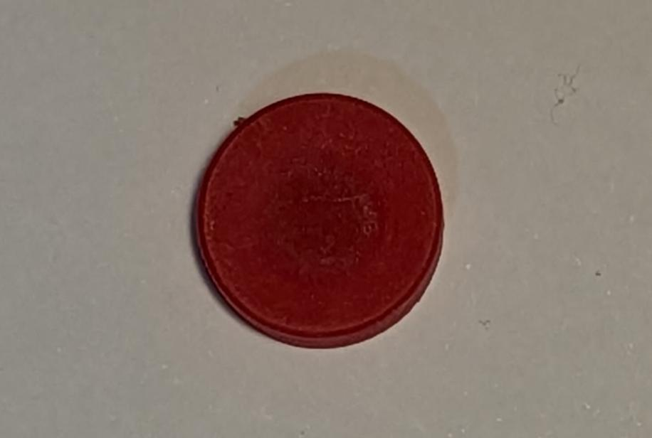
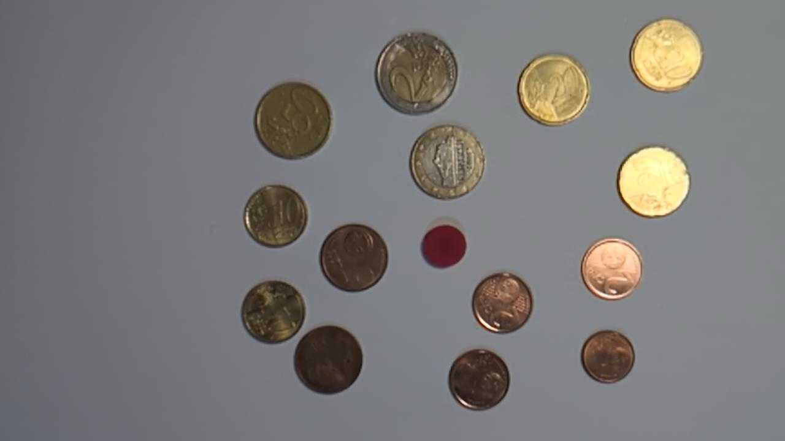
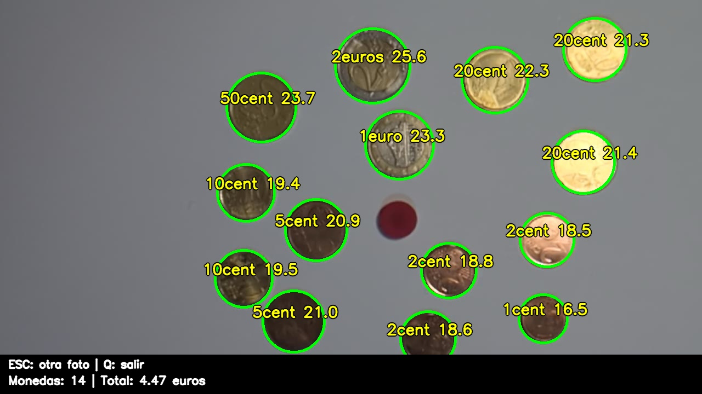
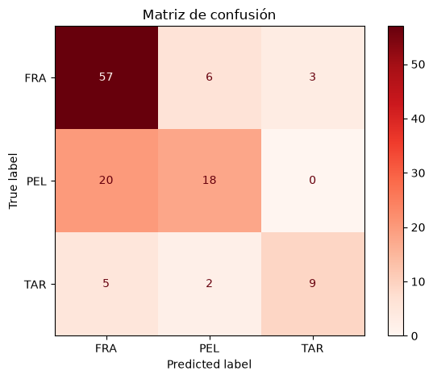
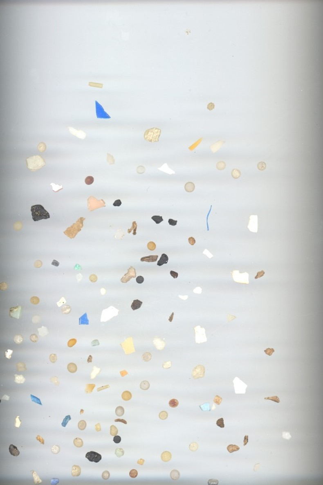
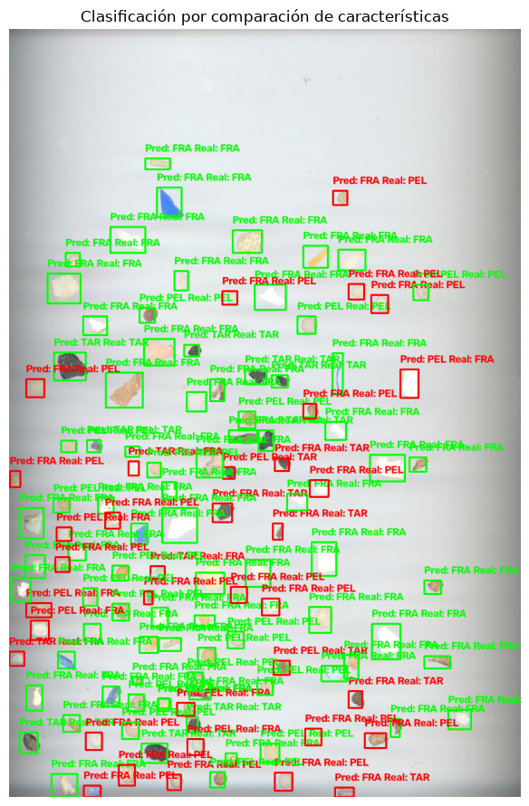

# Práctica 3
 
En esta tarea tratamos de distinguir diferentes objetos en la imagen utilizando parámetros como: el contorno, area, perimetro, diametro...
 
Hecho por:
  - [Eduardo Arbelo Rua-Figueroa](https://github.com/edulanarf)
  - [Pablo Campos Rico](https://github.com/pabr0)
## Índice
 
- [Monedas](#monedas)
- [Partículas](#partículas)
## Monedas
 
En esta tarea se trata de contar las monedas que aparecen en una foto hecha con la webcam y calcular cuánto dinero hay en total. Para saber el tamaño real de las monedas se ha colocado una ficha roja de 13,5 mm que sirve como referencia.
 
<br>
  <p align="center">
    
  </p>
<br>
En primer lugar, se guardan los diámetros, valores y el metal de cada moneda para poder compararlas más adelante:
 
```python
monedas_diametro = {
    "1cent": 16.25, "2cent": 18.75, "5cent": 21.25,
    "10cent": 19.75, "20cent": 22.25, "50cent": 24.25,
    "1euro": 23.25, "2euros": 25.75
}
metal = {
    "1cent": "cobre", "2cent": "cobre", "5cent": "cobre",
    "10cent": "oro", "20cent": "oro", "50cent": "oro",
    "1euro": "bimetal", "2euros": "bimetal"
}
```
 
### **Función procesar_imagen()**
 
Esta es la función principal, que se encarga de analizar la foto y devolverla con las monedas marcadas.
 
**1. Separar las monedas del fondo**
 
Primero se calcula el color del folio en cada zona de la imagen. De esta manera, aunque haya sombras, se pueden distinguir las monedas del fondo comparando el color de cada píxel con el del fondo:
 
```python
_, mascara = cv2.threshold(dif.astype(np.uint8), umbral, 255, cv2.THRESH_BINARY)
mascara = cv2.morphologyEx(mascara, cv2.MORPH_CLOSE, kernel, iterations=2)
mascara = cv2.morphologyEx(mascara, cv2.MORPH_OPEN, kernel, iterations=1)
```
 
**2. Quitar el ruido**
 
Luego se descartan los contornos que no parecen monedas: los muy pequeños, los que tocan el borde de la imagen y los que no son redondos. Para esto se utiliza la circularidad:
 
```python
circularidad = (4.0 * np.pi * area_c) / (perimetro * perimetro + 1e-9)
```
 
**3. Medir el diámetro**
 
Mediante la función `medir_diametro()` se trazan líneas desde el centro de cada moneda hacia fuera para encontrar dónde termina. Así se obtiene un diámetro más preciso que usando solo el contorno.
 
**4. Detectar el metal**
 
Usando los colores de la moneda (LAB y HSV) se decide si es de cobre, oro o bimetal:
 
```python
if plata < 60:
    metales.append("bimetal")
elif delta > 8 or tono < 17:
    metales.append("cobre")
elif delta < 4 or tono > 18.5:
    metales.append("oro")
```
 
**5. Ficha de referencia**
 
La ficha se detecta automáticamente por ser el objeto más rojo. Con ella calculamos la escala para pasar de píxeles a milímetros y la quitamos para que no se cuente como moneda:
 
```python
i_ficha = int(np.argmax(rojez))
escala = ficha_ideal_diametro / diametros[i_ficha]
```
 
Si hay algún objeto demasiado grande (más de 28 mm) suele ser porque hay dos monedas pegadas, así que se intentan separar con `cv2.HoughCircles`.
 
### **Función main()**
 
Se encarga de abrir la webcam y esperar a que el usuario pulse una tecla:
 
- `ESPACIO`: hace la foto y la analiza.
- `ESC`: vuelve a la webcam para hacer otra foto.
- `Q`: sale del programa.
 
En la pruebas se han detectado correctamente 14 de 14 monedas, obteniendo 4,47 € de los 4,47 € reales.
Se dibuja un círculo verde en cada moneda con su nombre y se muestra abajo el número de monedas y el dinero total:
 
<br>
  <p align="center">
    
  </p>
<br>
<br>
  <p align="center">
    
  </p>
<br>

## Partículas
 
En este trata de separar los diferentes elementos de la imagen en 3 grupos: FRA (fragments), PEL (pellets) y TAR. Para esto se han utilizado imágenes que contienen los 3 grupos por separado para obtener las características de estos y utilizar estas para diferenciar en una imagen con los 3 grupos conjuntos los elementos.
 
En primer lugar, se establece un area mínima para evitar utilizar contornos muy pequeños (desperfectos de la imagen):
 
```python
MIN_AREA = 10
```
 
### **Función loadImage()**  
Mediante esta función, cargamos una imagen en concreto y se lanza una excepción en caso de no encontrar una imagen:
 
```python
def load_image(path):
    image = cv2.imread(path)
 
    if image is None:
        raise FileNotFoundError(f"No se encuentra la imagen: {path}")
 
    return image
```
 
### **Función extract_particles()**  
 
Esta función se encarga de recortar las diferentes partículas de la imagen.
 
En primer lugar se aplica el umbralizado (OTSU):
 
```python
    _, mask = cv2.threshold(
        gray,
        0,
        255,
        cv2.THRESH_BINARY + cv2.THRESH_OTSU,
    )
```
 
Luego obtenemos el color predominante del fondo: De esta manera podemos saber si el borde de la partícula es blanco y el fondo negro o al contrario, borde negro y fondo blanco:
 
```python
    border = np.concatenate((
        mask[0, :],
        mask[-1, :],
        mask[:, 0],
        mask[:, -1],
    ))
    if np.mean(border) > 127:
        mask = cv2.bitwise_not(mask)
 
    contours, _ = cv2.findContours(
        mask,
        cv2.RETR_EXTERNAL,
        cv2.CHAIN_APPROX_SIMPLE,
    )
```
 
Por último se devuelven todos los contornos que tengan un area mayor a la propuesta (MIN_AREA=10):
 
```python
    return [
        contour
        for contour in contours
        if cv2.contourArea(contour) >= MIN_AREA
    ]
```
 
### **Función extract_features()**
 
Haciendo uso de esta función, extraemos las diferentes características de cada una de las partículas y las metemos en un array de Numpy:
 
- Área
- Circularidad
- Ratio de aspecto
- Ratio de elipse
- Solidez
- Colores (HSV)
### **Función build_reference_features()**
 
Mediante esta funcion se calculan las características reales de cada imagen de referencia FRA, PEL y TAR y las guardamos para poder compararlas mas adelante:
 
```python
    for label, path in train_images.items():
        image = load_image(path)
        gray = cv2.cvtColor(image, cv2.COLOR_BGR2GRAY)
        hsv = cv2.cvtColor(image, cv2.COLOR_BGR2HSV)
 
        contours = extract_particles(image, gray)
        features_list = [
            features
            for contour in contours
            if (
                features := extract_features(
                    image,
                    contour,
                    gray,
                    hsv,
                )
            ) is not None ]
```
 
### **Función fit_normalizer()**
 
Se normalizan las caracteristicas calculando el rango intercuartílico. Este rango mide la dispersión de los valores centrales de cada característica.
 
```python
    q75, q25 = np.percentile(
        all_features,
        [75, 25],
        axis=0,
    )
    scale = q75 - q25
    fallback = np.std(all_features, axis=0)
    scale = np.where(scale > 1e-8, scale, fallback)
    scale = np.where(scale > 1e-8, scale, 1.0)
 
    normalized_features = {
        label: (features - center) / scale
        for label, features in reference_features.items()
    }
```
 
### **Función classify_particle()**
 
Mediante esta función, se clasifica cada particula la cual se encuentra dentro de un recorte (crop). La clasificación se lleva acabo mediante las caracteristicas obtenidas en la función extract_features(). Estas características tienen un peso asignado:
 
- Circularidad	            :1.5
- Solidez	                  :1.5
- Relación de aspecto	      :1.5
- Relación de ejes	        :1.0
- Ocupación del rectángulo	:20.0
Recorremos el siguiente bucle:
 
```python
for label, reference_vectors in normalized_references.items():
```
En cada iteración se calcula la distancia geometrica para:
 
-  shape
-  color
Por otro lado, se calcula la distancia final sumando ```shape x peso de shape + color x peso de color```
 
```python
        shape_distances = np.sqrt(
            np.sum(
                differences[:, :5] ** 2 * FEATURE_WEIGHTS,
                axis=1,
            )
        )
 
        color_distances = np.linalg.norm(
            differences[:, 5:8],
            axis=1,
        )
 
        distances = (
            SHAPE_WEIGHT * shape_distances
            + COLOR_WEIGHT * color_distances
        )
```
 
por último se seleccionan las 3 referencias mas cercanas (K_NEIGHBORS = 3):
 
```python
k = min(K_NEIGHBORS, len(distances))
nearest = np.partition(distances, k - 1)[:k]
```
 
Y devolvemos la predicción:
 
```python
    prediction = min(class_distances, key=class_distances.get)
    return prediction, class_distances
```
 
### **Función evaluate_predictions()**
 
A través de esta función, se evaluan los datos obtenidos de las predicciones comparando los datos reales con los obtenidos.
 
En concreto, se encarga de crear la matriz de confusión:
 
```python
    classes = sorted(set(y_true) | set(y_pred))
 
    matrix = confusion_matrix(
        y_true,
        y_pred,
        labels=classes,
    )
 
    display = ConfusionMatrixDisplay(
        confusion_matrix=matrix,
        display_labels=classes,
    )
 
    display.plot(cmap="Reds", values_format="d")
    plt.title("Matriz de confusión")
    plt.tight_layout()
    plt.show()
```
 
**MATRIZ CONFUSIÓN**
 
Como se puede observar en la matriz confusión, se han detectado correctamente un 70% de las partículas. Entre estas se han acertado correctamente: 57 FRA, 18 PEL y 9 TAR, es decir 84 partículas de 120. Por otro lado, se han detectado de manera errónea: 6 PEL y 3 TAR que deberían haberse detectado como FRA, 20 FRA que deberían haberse detectado como PEL y por último 5 FRA y 2 PEL que deberían haberse detectado como TAR.  
 
Mediante estos datos podemos concluir que la detección se ha realizado de manera exitosa para los FRA y los TAR. En cambio los PEL se han identificado mayormente como FRA.
 
<br> 
  <p align="center">
    
  </p>
<br>
 
### **Función classify_test_image()**
 
Esta funcion se encarga de conectar el clasificador con los datos obtenidos de la imagen del test. Se pueden observar los resultados correctos rodeados de un cuadrado verde y los incorrectos de color rojo.
 
 
**DETECCIÓN DE PARTÍCULAS**
 
<br> 
  <p align="center">
    
    
  </p>
<br>
### **Función main()**
 
Orden de ejecución:
 
1. build_reference_features(TRAIN_IMAGES): extrae las características de las imágenes de referencia FRA, PEL y TAR.
2. fit_normalizer(reference_features): calcula los valores necesarios para normalizar las características y normaliza las referencias.
3. classify_test_image(...): analiza la imagen de prueba, extrae sus partículas y las clasifica comparándolas con las referencias normalizadas.
4. evaluate_predictions(y_true, y_pred): evalúa los resultados de la clasificación mediante métricas y la matriz de confusión.
5. plt.figure(...): crea la figura donde se mostrará la imagen resultante.
6. plt.imshow(result_image): muestra la imagen con las partículas clasificadas.
7. plt.title(...): añade el título a la figura.
8. plt.axis("off"): oculta los ejes.
9. plt.tight_layout(): ajusta la distribución de la figura.
10. plt.show(): muestra la figura en pantalla.
