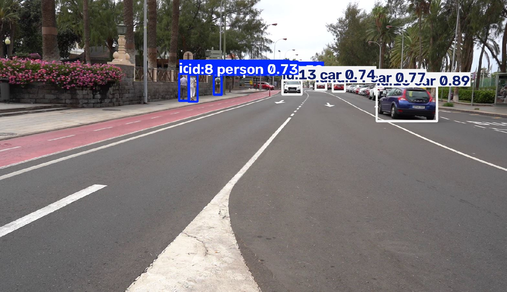
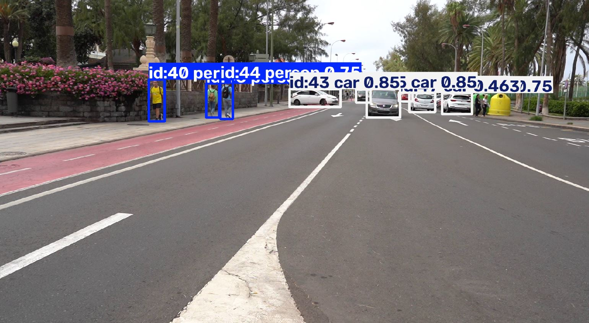
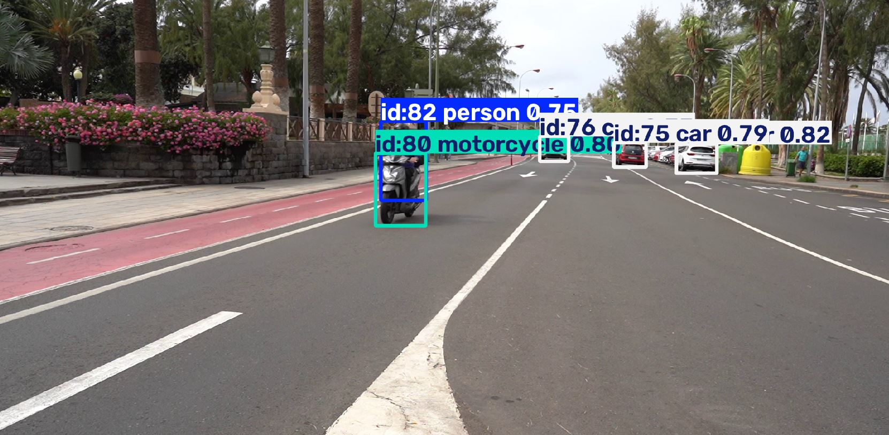
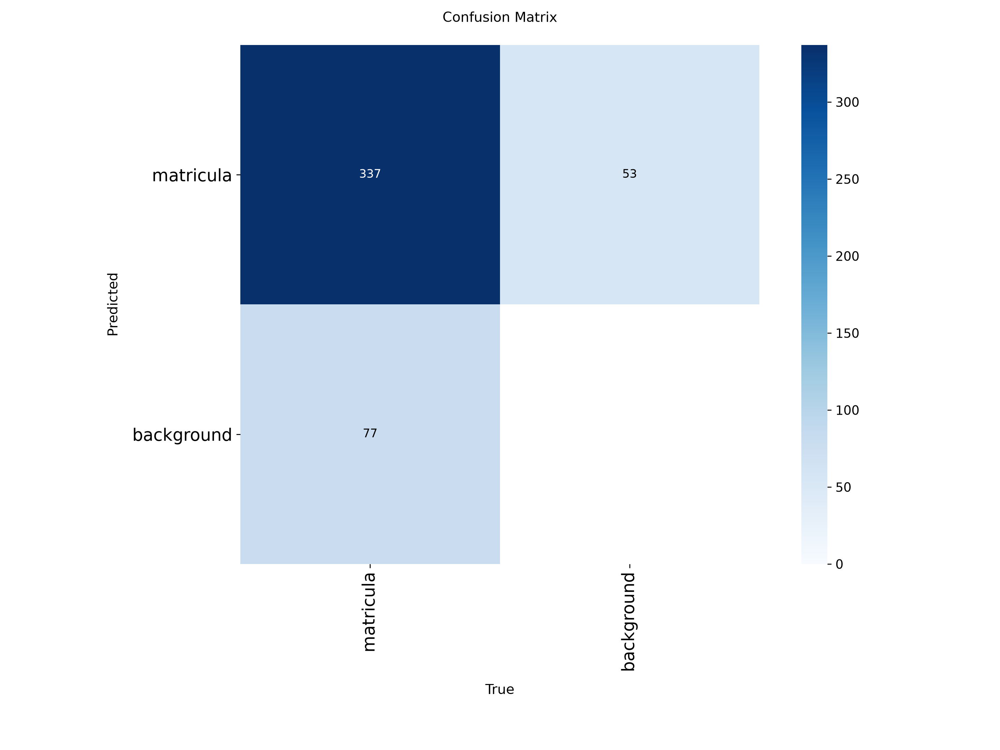

# Práctica 4
 
Entrenamiento de un modelo para detectar matrículas para posteriormente leerlas utilizando OCR. Por otro lado también se hace uso de el modelo de yolo26 para detectar vehículos y personas
 
Hecho por:
  - [Eduardo Arbelo Rua-Figueroa](https://github.com/edulanarf)
  - [Pablo Campos Rico](https://github.com/pabr0)
## Índice
 
- [Modelo](#modelo)
- [OCR](#ocr)

## Modelo

### Detección de vehículos y personas

<br>
  <p align="center">
    
  </p>
<br>

En este apartado, se ha utilizado el modelo de yolo26s para obtener el mejor resultado posible a la hora de detectar vehículos y personas. En primer lugar, se debe definir cuál es el índice de una clase concreta para este modelo:

```python
clase_persona = 0
clases_vehiculos = {1, 2, 3, 5, 7} # bicicleta, coche, moto, guagua, camión
nombres = {0: "persona", 1: "bicicleta", 2: "coche", 3: "moto", 5: "guagua", 7: "camion"}
```

En un primer lugar, se contaban los vehículos y personas sin ninguna restricción, es decir, se contaban todos los vehículos de la imagen como pueden ser vehículos aparcados (no están en movimiento) llegando a contar en torno a los 60 vehículos. Debido a esto, se impuso la condición de que el vehículo debe estar en movimiento de la siguiente manera:

```python
MIN_FRAMES = 15            # fotogramas mínimos que tiene que salir
MIN_DESPL_VEHICULO = 0.10  # lo que se tiene que mover, en proporción al ancho del vídeo
MIN_DESPL_PERSONA = 0.05   # las personas van más despacio, así que se pide menos
```

En segundo lugar, se realiza el tracking de objetos en el video. Se utilizan los siguientes parámetros:

```python
results = model.track(source=filename,
   show=True,
   stream=True,
   persist=True,
   verbose=False,
   classes=[clase_persona, *clases_vehiculos])

```

- show: 	Muestra en pantalla el vídeo con las detecciones y los identificadores
- stream: Procesa el vídeo fotograma a fotograma, devolviendo los resultados progresivamente
- persist: 	Mantiene los identificadores de seguimiento entre fotogramas consecutivos (no contamos varias veces el mismo objeto)
- verbose: 	Evita mostrar demasiada información en la consola
- classes: Filtra las detecciones para mostrar únicamente personas y vehículos seleccionados

Por otro lado, se hace uso de una función "clase_mayoritaria" debido a que en ocasiones, un vehículo se detecta como dos tipos en diferentes fotogramas, ejemplo: un coche se empieza detectando como "coche" pero en un fotograma concreto se detecta como "camión". Mediante esta clase nos aseguramos de obtener la clase predominante en el total de los fotogramas:

```python
def clase_mayoritaria(puntos):
    clases = [c for c, x, y in puntos]
    return Counter(clases).most_common(1)[0][0]
```

También contamos con funciones para detectar cuánto se ha desplazado un objeto concreto (para descartarlo o añadirlo a la lista para contarlo) y para determinar si un objeto se cuenta o no:

```python
def cuanto_se_mueve(puntos):
    centros = np.array([(x, y) for c, x, y in puntos])
    inicio = centros[:5].mean(axis=0)
    final = centros[-5:].mean(axis=0)
    return np.linalg.norm(final - inicio)
```

```python
def se_cuenta(puntos):
    if clase_mayoritaria(puntos) == clase_persona:
        minimo = MIN_DESPL_PERSONA * ancho
    else:
        minimo = MIN_DESPL_VEHICULO * ancho
    return len(puntos) >= MIN_FRAMES and cuanto_se_mueve(puntos) >= minimo
```

Por último, se recorre un diccionario llamado historial anteriormente creado el cuál contiene:
- ID: identificador único asignado por el tracker a cada persona o vehículo detectado.
- Lista de posiciones: coordenadas del centro de la caja delimitadora (x, y) en cada fotograma en el que se ha detectado el objeto.
- Clase del objeto: indica a qué categoría pertenece cada detección.

Mediante este bucle, comprobamos si se debe de contar el objeto utilizando la función "se_cuenta", posteriormente obtenemos el id de la clase utilizando la función "clase_mayoritaria" y se suma en la lista correspondiente el vehículo o la persona:

```python
for track_id, puntos in historial.items():
    if not se_cuenta(puntos):
        continue
    class_id = clase_mayoritaria(puntos)
    if class_id == clase_persona:
        ids_personas.add(track_id)
    else:
        ids_vehiculos.add(track_id)
    conteo[nombres[class_id]] += 1
```

Resultados obtenidos en la ejecución de este programa (solo contando objetos en movimiento):

PERSONAS:  [4, 8, 9, 12, 24, 26, 33, 40, 44, 46, 51, 57, 72, 77, 82, 83, 85, 96]  
VEHICULOS:  [1, 10, 11, 13, 15, 17, 20, 22, 25, 27, 30, 34, 37, 41, 43, 45, 49, 52, 56, 62, 74, 75, 76, 78, 80, 88, 90, 92, 94, 95, 101, 103]  
**Total PERSONAS:  18**  
**Total VEHICULOS:  32**  
Por clase: {'guagua': 1, 'persona': 18, 'coche': 27, 'moto': 3, 'bicicleta': 1}  

Podemos ver que hemos obtenido dos listas diferentes con los ids de los objetos. Por otro lado hemos obtenido un total de 18 personas y 32 vehículos diferentes. De estos vehículos 1 ha sigo una guagua, 27 han sido coches, 3 motos y 1 bicicleta.  

En caso de ejecutar el modelo sin ninguna restricción de movimiento, obtendríamos los siguientes resultados:

PERSONAS: [4, 8, 9, 12, 19, 24, 26, 29, 31, 32, 33, 39, 40, 44, 46, 51, 53, 57, 58, 61, 67, 68, 71, 72, 77, 82, 83, 85, 96]  
VEHICULOS: [1, 2, 3, 5, 6, 7, 10, 11, 13, 14, 15, 16, 17, 18, 20, 21, 22, 23, 25, 27, 28, 30, 34, 35, 36, 37, 41, 42, 43, 45, 47, 48, 49, 52, 54, 56, 62, 64, 65, 73, 74, 75, 76, 78, 79, 80, 84, 86, 88, 90, 91, 92, 93, 94, 95, 97, 98, 99, 100, 101, 103, 104, 105, 106, 107]  
**Total PERSONAS: 29**  
**Total VEHICULOS: 65**  
Por clase: {'guagua': 1, 'coche': 60, 'persona': 29, 'moto': 3, 'bicicleta': 1}  

Como era de esperar, hemos obtenido un mayor número de vehículos ya que ahora también se cuentan vehículos que aparecen en pantalla mas de 15 frames y que se no se desplazan en el vídeo. Por otro lado, el número de personas también ha aumentado a 29. Esto puede ser debido a que se trata de personas que aparecen solo unos pocos frames debido a que la detección fue muy dificil por la lejanía y antes se descartaba.

<br>
  <p align="center">
    
  </p>
<br>

<br>
  <p align="center">
    
  </p>
<br>

### Detección de matrículas de los vehículos presentes

Para realizar este apartado es necesario entrenar un modelo utilizando un dataset de imagenes con matrículas de vehículos. Los creadores de el dataset se encuentran en el fichero autoría.txt. El dataset esta formado por un total de 2350 imagenes.

Entrenamiento del modelo:

Se carga el modelo de yolo11n y utilizamos la función de train para entrenarlo. Se establecen los siguientes parámetros:

- **data**: ruta del archivo dataset.yaml, que contiene la configuración del dataset.
- **epochs=100**: establece un máximo de 100 épocas de entrenamiento.
- **imgsz=1920**: establece el tamaño de entrada de las imágenes en 1920 píxeles.
- **batch=8**: indica que se procesarán 8 imágenes por lote antes de actualizar los pesos.
- **patience=20**: permite detener anticipadamente el entrenamiento si no se producen mejoras durante 20 épocas consecutivas.
- **name="detector_matriculas"**: asigna un nombre al experimento.
- **project="runs/detect"**: establece el directorio donde se guardarán los resultados.
- **pretrained=True**: utiliza los pesos preentrenados de YOLO11n como punto de partida.
- **resume=True**: permite reanudar un entrenamiento anterior desde el último checkpoint guardado.
- **save=True**: habilita el guardado de los pesos y checkpoints del modelo.

```python
model = YOLO('yolo11n.pt')

results = model.train(
        data=r"C:\Users\Usuario\Desktop\P4 VC\dataset.yaml",
        epochs=100,
        imgsz=1920,
        batch=8,
        patience=20, 
        name="detector_matriculas",
        project="runs/detect",
        save=True
    )
```

El modelo ha sido entrenado en un ordenador con las siguientes características: i5-14600kf, 5060Ti, 32GB ram de 3200mhz y 1 SSD 1TB.  
Una vez entrenado el modelo se han obtenido los siguientes resultados:  

<br>
  <p align="center">
    
  </p>
<br>


## OCR
