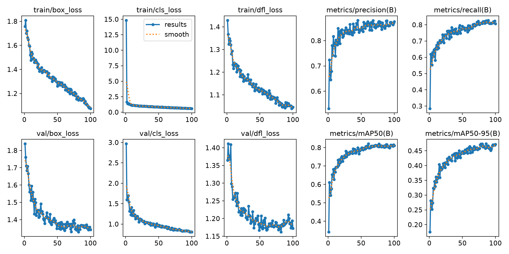
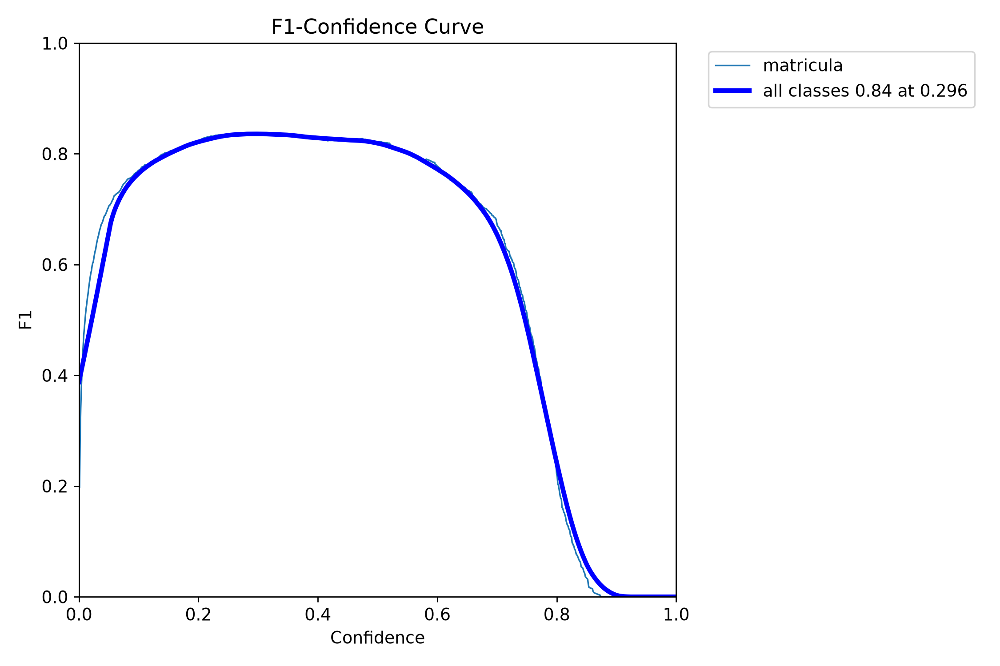
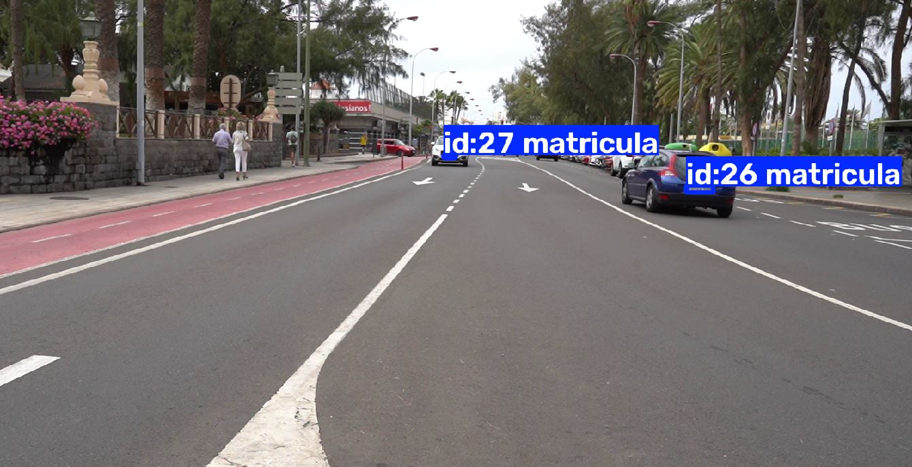
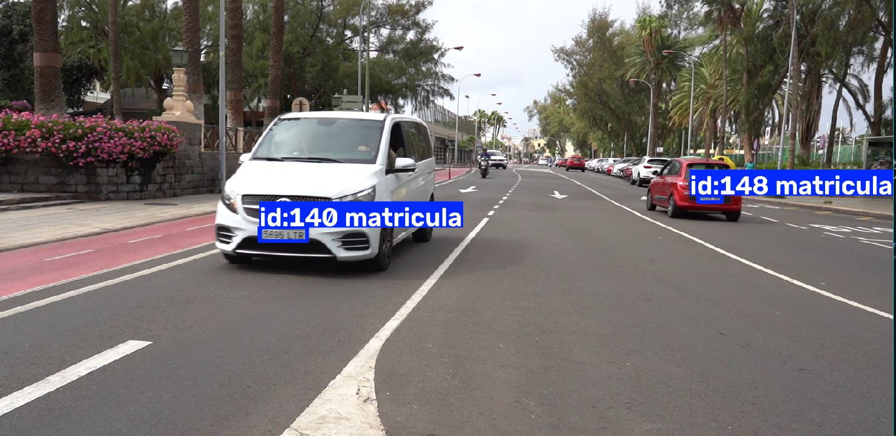
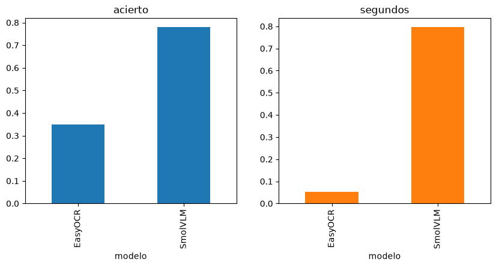

# Práctica 4
 
Entrenamiento del modelo yolo11n para detectar matrículas para posteriormente leerlas utilizando OCR. Por otro lado también se hace uso del modelo de yolo26s para detectar vehículos y personas.
 
Hecho por:
  - [Eduardo Arbelo Rua-Figueroa](https://github.com/edulanarf)
  - [Pablo Campos Rico](https://github.com/pabr0)
## Índice
 
- [Modelo](#modelo)
- [OCR](#ocr)
- [CSV y vídeo](#csv-y-vídeo)

## Modelo

### Detección de vehículos y personas

<br>
  <p align="center">
    
  </p>
<br>

En este apartado, se ha utilizado el modelo de yolo26s para obtener el mejor resultado posible a la hora de detectar vehículos y personas. Definimos el índice de una clase concreta para este modelo:

```python
nombres = {0: "persona", 1: "bicicleta", 2: "coche", 3: "moto", 5: "guagua", 7: "camion"}
```

En un primer lugar, se contaban los vehículos y personas sin ninguna restricción, por lo que también se contaban los vehículos aparcados. Por eso, finalmente solo contamos los objetos que se mueven.

En segundo lugar, se realiza el tracking de objetos en el video. Se utilizan los siguientes parámetros:

```python
model.track(VIDEO,
   show=True,
   stream=True,
   persist=True,
   verbose=False,
   classes=list(nombres))
```

- **show**: 	Muestra en pantalla el vídeo con las detecciones y los identificadores.
- **stream**: Procesa el vídeo fotograma a fotograma, devolviendo los resultados progresivamente.
- **persist**: 	Mantiene los identificadores de seguimiento entre fotogramas consecutivos, evitando contar varias veces el mismo objeto.
- **verbose**: 	Evita mostrar demasiada información en la consola.
- **classes**: Filtra las detecciones para mostrar únicamente personas y vehículos seleccionados.

Por otro lado, en ocasiones un vehículo se detecta como dos tipos en diferentes fotogramas, ejemplo: un coche se empieza detectando como "coche" pero en un fotograma concreto se detecta como "camión". Por eso nos quedamos con el tipo que más veces se le ha asignado en el total de los fotogramas:

```python
tipo = Counter(tipos[id]).most_common(1)[0][0]
```

Para decidir si un objeto se cuenta o no, miramos cuánto se ha desplazado: la distancia entre el punto donde aparece por primera vez y donde se ve por última vez tiene que superar el 10 % del ancho del vídeo en los vehículos y el 5 % en las personas, que van más despacio:

```python
for id in recorrido:
    tipo = Counter(tipos[id]).most_common(1)[0][0]
    minimo = 0.05 if tipo == "persona" else 0.10
    if math.dist(recorrido[id][0], recorrido[id][-1]) > minimo * ancho:
        contados[id] = tipo
```

Donde "recorrido" es un diccionario que guarda, para cada ID asignado por el tracker, las coordenadas del centro de la caja delimitadora (x, y) en cada fotograma en el que se ha detectado el objeto.

Resultados obtenidos en la ejecución de este programa (solo contando objetos en movimiento):

**Total PERSONAS:  18**  
**Total VEHICULOS:  33**  
Por clase: {'coche': 28, 'persona': 18, 'moto': 3, 'guagua': 1, 'bicicleta': 1}  

Hemos obtenido un total de 18 personas y 33 vehículos diferentes. De estos vehículos 1 ha sido una guagua, 28 han sido coches, 3 motos y 1 bicicleta.  

En caso de ejecutar el modelo sin ninguna restricción de movimiento, obtendríamos los siguientes resultados:

**Total PERSONAS: 29**  
**Total VEHICULOS: 65**  
Por clase: {'guagua': 1, 'coche': 60, 'persona': 29, 'moto': 3, 'bicicleta': 1}  

Como era de esperar, hemos obtenido un mayor número de vehículos ya que ahora también se cuentan los vehículos que no se desplazan en el vídeo. Además, a los coches aparcados el tracker les asigna un ID nuevo cada vez que otro vehículo los tapa, por lo que el mismo coche se cuenta varias veces. Por otro lado, el número de personas también ha aumentado a 29. Esto puede ser debido a que se trata de personas que aparecen solo unos pocos frames debido a que la detección fue muy difícil por la lejanía y antes se descartaba.

<br>
  <p align="center">
    
  </p>
<br>

<br>
  <p align="center">
    
  </p>
<br>

### Detección de matrículas de los vehículos presentes

Para realizar este apartado es necesario entrenar un modelo utilizando un dataset de imágenes con matrículas de vehículos. Los creadores del dataset se encuentran en el fichero autoría.txt. El dataset está formado por un total de 2350 imágenes.

Acceso al dataset: [https://drive.google.com/drive/folders/1RFd6sKH_QMQcpE_w5rWmy8rKiYUY5_SI](https://drive.google.com/drive/folders/1RFd6sKH_QMQcpE_w5rWmy8rKiYUY5_SI)

Entrenamiento del modelo:

Se carga el modelo de yolo11n y utilizamos la función de train para entrenarlo. Se establecen los siguientes parámetros:

- **data**: ruta del archivo dataset.yaml, que contiene la configuración del dataset.
- **epochs=100**: establece un máximo de 100 épocas de entrenamiento.
- **imgsz=1920**: establece el tamaño de entrada de las imágenes en 1920 píxeles.
- **batch=8**: indica que se procesarán 8 imágenes por lote antes de actualizar los pesos.
- **patience=20**: permite detener anticipadamente el entrenamiento si no se producen mejoras durante 20 épocas consecutivas.
- **name="detector_matriculas"**: asigna un nombre al experimento.
- **project="runs/detect"**: establece el directorio donde se guardarán los resultados.
- **save=True**: habilita el guardado de los pesos y checkpoints del modelo.

```python
model = YOLO('yolo11n.pt')

results = model.train(
        data=r"C:\Users\Usuario\Desktop\P4 VC\dataset.yaml",
        epochs=100,
        imgsz=1920,
        batch=8,
        patience=20, 
        name="detector_matriculas",
        project="runs/detect",
        save=True
    )
```

El modelo ha sido entrenado en un ordenador con las siguientes características: i5-14600kf, 5060Ti, 32GB ram de 3200mhz y 1 SSD 1TB.  
Una vez entrenado el modelo se han obtenido los siguientes resultados:  

<br>
  <p align="center">
    
  </p>
<br>

En esta imagen observamos diferentes tipos de gráficas. En la primera fila obtenemos los resultados durante el entrenamiento y en la segunda fila los de la validación:

- train/box_loss: **Error en la localización de las cajas**
- train/cls_loss: **Error de clasificación**
- train/dfl_loss: **Error de distribución focal** (medida del error relacionada con la localización de las cajas delimitadoras, ayuda al modelo a ajustar mejor las coordenadas de los bordes de las cajas)
- metrics/precision(B): **Precisión**, Indica qué proporción de las detecciones realizadas por el modelo son realmente correctas
- metrics/recall(B): **Exhaustividad**, Indica qué proporción de las matrículas reales existentes en las imágenes consigue detectar el modelo

De la segunda fila podemos destacar:
- metrics/mAP50(B): **Mean Average Precision - 50%**, Métrica que evalúa la capacidad general del modelo para detectar correctamente los objetos. Considera una detección como correcta cuando la superposición entre la caja predicha y la caja real es igual o superior al 50 %.
- metrics/mAP50-95(B): **Mean Average Precision -50 % al 95 %**, Métrica más exigente que la anterior, ya que calcula la precisión media utilizando diferentes umbrales de IoU, desde el 50 % hasta el 95 %, aumentando de 5 % en 5 %.

En general se han obtenido unos resultados bastante buenos en el entrenamiento. Se ha alcanzado una precisión cercana al 85 %, lo que indica que la mayoría de las matrículas detectadas por el modelo son correctas. Además, se observa una evolución favorable de las pérdidas durante el entrenamiento y la validación, disminuyendo de manera constante a medida que aumentan las épocas. Esto demuestra que el modelo ha conseguido aprender las características necesarias para identificar matrículas a partir del conjunto de datos proporcionado.  

Por otro lado, en la gráfica del train/cls_loss se puede observar una caída drástica en la primera época del entrenamiento. Esto puede deberse a varios motivos:
- **Adaptación al nuevo conjunto de datos**: aunque se parte de un modelo preentrenado, este ha aprendido previamente a detectar objetos de otras categorías. Al entrenarlo con el dataset de matrículas, debe adaptar sus capas de detección y clasificación a la nueva tarea.
- **Inicialización de las capas de detección**: las predicciones iniciales del modelo todavía no están suficientemente ajustadas a las matrículas de nuestro conjunto de datos. Por ello, los primeros errores pueden ser elevados.

Mediante la gráfica F1, se puede ver que tan bueno es el modelo (combina precisión y recall) dependiendo de la confianza dada. En nuestro caso hemos decidido que con una confianza de 0.3 funciona mejor:

<br>
  <p align="center">
    
  </p>
<br>

Sabiendo ya la confianza que debemos dar al modelo, ejecutamos el modelo con las imágenes de test. En el test usamos una confianza de 0.35, un poco más exigente, para que salgan menos falsos positivos en la matriz de confusión:

```python
metrics = model_mat.val(
    data="dataset.yaml",
    split="test",
    imgsz=1920,
    batch=4,
    conf=0.35,
    plots=True
)
```

Se evalúan 229 imágenes de test con 531 matrículas (YOLO descarta 8 imágenes porque su anotación tiene las coordenadas en píxeles en vez de normalizadas). Se obtiene un **mAP50 de 0,749** y un **mAP50-95 de 0,47**.

Mediante este programa obtenemos la siguiente matriz de confusión:

<br>
  <p align="center">
    
  </p>
<br>

En la matriz de confusión podemos ver que se han detectado correctamente 439 matrículas. Por otro lado se detectan 51 objetos como matrículas que no lo son y hay 92 matrículas que no se detectan. A partir de estos resultados, obtenemos una precisión del 89,6 %, lo que significa que la mayoría de las detecciones realizadas por el modelo son correctas. Además, se calcula que tiene un recall del 82,7 %, indicando que consigue detectar aproximadamente 8 de cada 10 matrículas presentes en las imágenes.

### Detección de matrículas en el vídeo

En este caso solo buscamos las matrículas de los vehículos que están en movimiento. Para ello, recortamos cada vehículo contado y buscamos la matrícula dentro del recorte con nuestro modelo, usando la confianza de 0.3 obtenida antes:

```python
mat = model_mat(frame[y1:y2, x1:x2], conf=0.3, verbose=False)[0].boxes
```

De esta forma cada matrícula queda asociada directamente a su vehículo. Las coordenadas que devuelve el modelo son del recorte, así que les sumamos la esquina del vehículo para pasarlas a la imagen entera. Además, de cada vehículo guardamos hasta 10 fotos de su matrícula (las que tienen al menos 30 píxeles de ancho) para leerlas después con el OCR.

<br>
  <p align="center">
    
  </p>
<br>

<br>
  <p align="center">
    
  </p>
<br>

## OCR

Para leer las matrículas probamos dos modelos:

- **EasyOCR**: OCR clásico basado en redes neuronales. Es rápido y fácil de instalar.
- **SmolVLM-Instruct**: modelo de visión y lenguaje (VLM). Le pasamos la foto de la matrícula y le preguntamos *"Read the license plate. Answer only with its characters."*. Se carga con la librería transformers en media precisión (bfloat16) para que quepa en la gráfica, y con `do_image_splitting=False` para que no trocee la imagen, ya que si no va muchísimo más lento.

A la respuesta de los dos le aplicamos la misma limpieza: mayúsculas y solo letras y números.

### Lectura de las matrículas del vídeo

Para el vídeo usamos SmolVLM, ya que es el que más acierta (ver la comparativa). Cada vehículo tiene hasta 10 fotos de su matrícula; las leemos todas y nos quedamos con la lectura que más se repite. Así una lectura mala suelta no estropea el resultado:

```python
for id, fotos in recortes.items():
    lecturas = [leer_smolvlm(foto) for foto in fotos]
    texto_matricula[id] = Counter(lecturas).most_common(1)[0][0]
```

De los 33 vehículos contados, se ha obtenido una lectura en 27 (en el resto no se llegó a ver la matrícula con suficiente tamaño). De esas 27, **12 son matrículas completas con el formato correcto** (4 números y 3 letras), por ejemplo `2916FGN`, `9786LCF` o `8098JXM`. Otras salen casi bien pero con algún carácter confundido, como `7339L66` (7339LGG), `S143LC` o `S017HDD`, y en algunas la lectura no tiene sentido (`13222222`, `CGUG`).

Las matrículas que no se leen bien suelen ser de coches lejanos o que se alejan, ya que la matrícula ocupa muy pocos píxeles y sale movida. Además, aunque en el test SmolVLM acierta el 78 %, allí las matrículas están recortadas a mano y bien enfocadas, mientras que en el vídeo son mucho más pequeñas.

### Comparativa EasyOCR vs SmolVLM

Para que la comparación sea justa, los dos modelos leen exactamente lo mismo:

- **Datos**: 100 matrículas de las imágenes de test que tienen el texto anotado, recortadas con su caja anotada.
- **Acierto**: la matrícula leída tiene que coincidir entera con la real.
- **Tiempo**: lo que tarda cada lectura, de media.

<br>
  <p align="center">
    
  </p>
<br>

| Modelo  | Acierto | Tiempo medio por matrícula |
|---------|---------|----------------------------|
| EasyOCR | 35 %    | 0,052 s                    |
| SmolVLM | 78 %    | 0,797 s                    |


Conclusiones:
- **SmolVLM acierta más del doble** que EasyOCR. Los fallos típicos de EasyOCR son: leer las letras antes que los números, comerse caracteres, confundir caracteres parecidos o no leer nada.
- **EasyOCR es unas 15 veces más rápido**, por lo que para procesar vídeo en tiempo real sería la opción viable.
- Es el equilibrio que esperábamos: el OCR clásico es rápido y el VLM es más preciso pero mucho más costoso. Como en el vídeo cada vehículo solo se lee unas pocas veces, nos compensa usar SmolVLM.

La comparativa se ha hecho en un ordenador con las siguientes características: i7-10870H, RTX 3070 Laptop (8 GB), 32GB ram, Windows 11, Python 3.14 y PyTorch 2.15 con CUDA.

## CSV y vídeo

El archivo `resultado.csv` tiene una fila por cada objeto contado y fotograma, con los siguientes campos:

```
fotograma, tipo_objeto, confianza, identificador_tracking, x1, y1, x2, y2,
matrícula_en_su_caso, confianza_matricula, mx1, my1, mx2, my2, texto_matricula
```

Las columnas de la matrícula (mx1, my1, mx2, my2 y su confianza) solo se rellenan en los fotogramas en los que se detecta la matrícula, mientras que texto_matricula va en todas las filas del vehículo, ya que es la lectura final de su matrícula.

En el vídeo se ven las cajas de las personas y los vehículos con su tipo y su ID, la matrícula en amarillo con el texto leído debajo, y el total de personas y vehículos arriba a la izquierda.

### Vídeo de la detección de matrículas

<!-- ACTUALIZAR con el enlace al vídeo nuevo (con el texto de las matrículas) -->
https://drive.google.com/file/d/1CPG97xLR6oI7a9Uq4c9Y-G3Oq1INkNBA/view?usp=sharing 
