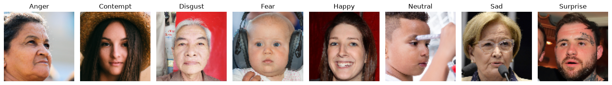
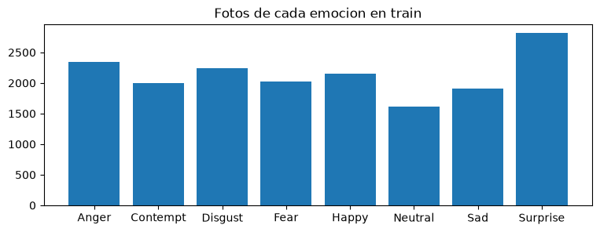
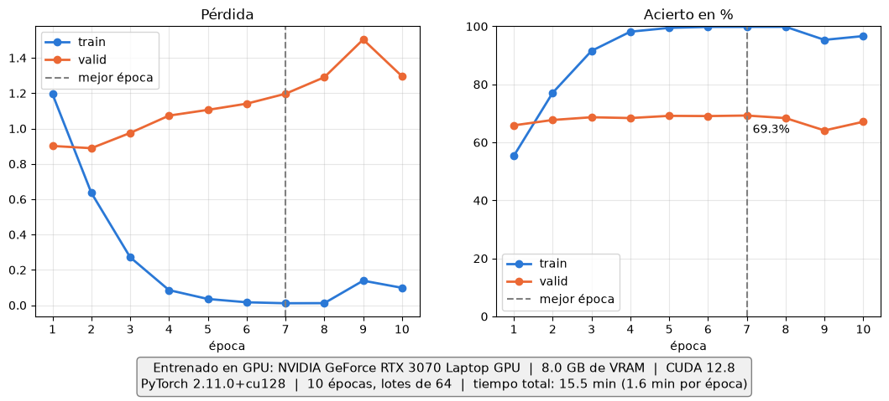
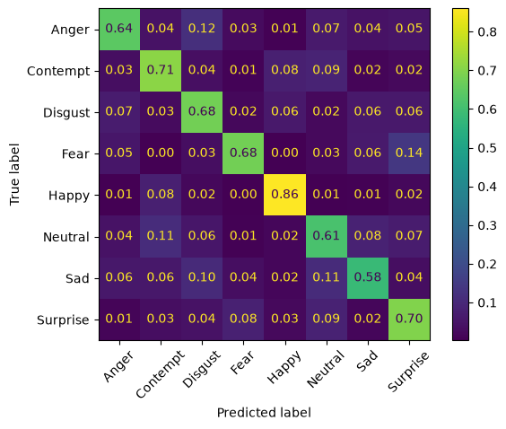
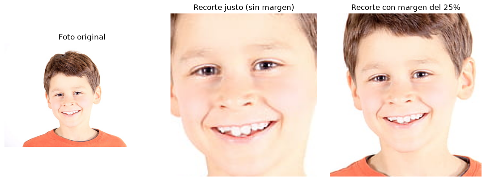

# Práctica 5

Biometría: Detección y caracterización de caras
 
Hecho por:
  - [Eduardo Arbelo Rua-Figueroa](https://github.com/edulanarf)
  - [Pablo Campos Rico](https://github.com/pabr0)

## Índice 
- [Filtro sin entrenamiento](#filtro-sin-entrenamiento)
- [Entrenamiento del detector de emociones](#entrenamiento-del-detector-de-emociones)
- [Juego: Simón dice emociones](#juego-simón-dice-emociones)

## Filtro sin entrenamiento
Para este apartado hemos decidido desarrollar un filtro facial añadiendo al rostro unas gafas de sol. Por otro lado también realizamos una animación al abrir la boca en forma de "o" haciendo que salga humo de ella.

### Configuración del detector facial
En primer lugar, configuramos el detector facial de MediaPipe. Para esto hacemos uso de la API "task" de MediaPipe, concretamente de la herramienta FaceLandmarker la cual nos permite detectar los puntos de referencia de la cara (llamados landmarks):

```python
BaseOptions = mp.tasks.BaseOptions
FaceLandmarker = mp.tasks.vision.FaceLandmarker
FaceLandmarkerOptions = mp.tasks.vision.FaceLandmarkerOptions
VisionRunningMode = mp.tasks.vision.RunningMode
```

- BaseOptions: establece las opciones basicas del modelo
- Facelandmarker: detector que se encarga de detectar los landmarks
- FaceLandmarkerOptions: configuración de los landmarks
- VisionRunningMode: modo en el que se procesarán las imagenes

Se crea un objeto "options" para establecer las opciones mas importantes. En este caso definimos cual es la ruta de "face_landmarker.task" (modelo para la detección), el modo de procesamiento como video y el número de caras a 1.:

```python
options = FaceLandmarkerOptions(
    base_options=BaseOptions(model_asset_path="face_landmarker.task"),
    running_mode=VisionRunningMode.VIDEO,
    num_faces=1
)
```

### Colocar gafas en el rostro
Se crea un objeto "gafas" que contiene un png de las gafas de sol

```python
gafas = cv2.imread("gafas.webp", cv2.IMREAD_UNCHANGED)
```

Creamos una función para colocar las gafas. Esta función tendrá como parámetros:
- frame: fotograma actual del video
- imagen: imagen de las gafas
- centro: coordenadas donde se colocan las gafas
- ancho: ancho de las gafas (ajustado a mano)
- angulo: angulo de inclinación que tienen que tener las gafas para adaptarse a los movimientos de la cara (se actualiza en cada frame)
  
```python
def poner_gafas(frame, imagen, centro, ancho, angulo):
```

Seguido de la definición de la función, se establece una altura para las gafas en función del ancho y un overlay para aplicar las nuevas dimensiones de las gafas:

```python
    alto = int(imagen.shape[0] * ancho / imagen.shape[1])
    overlay = cv2.resize(imagen, (ancho, alto))
```

Para que al inclinar las gafas no se salga del recuadro que tiene definido, calculamos como de grande debe ser aplicando el teorema de Pitágoras para calcular la diagonal de la imagen. Luego se crea una imagen con 4 canales de color (inicialmente transparente) BGRA:

```python
    diagonal = int(np.sqrt(ancho**2 + alto**2)) + 10

    lienzo = np.zeros(
        (diagonal, diagonal, 4), dtype=np.uint8
    )
```

Después de crear el lienzo transparente, colocamos las gafas en el centro de este:

```python
    x_inicio = (diagonal - ancho) // 2
    y_inicio = (diagonal - alto) // 2

    lienzo[
        y_inicio:y_inicio + alto,
        x_inicio:x_inicio + ancho
    ] = overlay
```

Aplicamos la inclinación de las gafas:

```python
matriz = cv2.getRotationMatrix2D(
        (diagonal // 2, diagonal // 2),
        angulo,
        1 #escala
    )

    overlay = cv2.warpAffine(
        lienzo,
        matriz,
        (diagonal, diagonal),
        flags=cv2.INTER_LINEAR,
        borderMode=cv2.BORDER_CONSTANT,
        borderValue=(0, 0, 0, 0)
    )
```

Gracias a la función "getRotationMatrix2D()" podemos aplicar una matriz de transformación a las gafas que permite girarlas un ángulo determinado. Posteriormente mediante la función "warpAffine()" aplicamos esta matriz transformación a la imagen.

Por útlimo, como ya tendríamos las gafas con la inclinación y el tamaño correcto dentro de su lienzo, solo quedaría calcular donde deben de colocarse en el fotograma. En este caso, el parámetro "centro" representa el punto entre los dos ojos, por lo que debemos calcular las coordenadas de la esquina superior izquierda del lienzo, restando a las coordenadas del centro la mitad de la diagonal del mismo. De esta manera, conseguimos que el centro del lienzo coincida con el punto situado entre los dos ojos:

```python
x = int(centro[0] - diagonal / 2)
y = int(centro[1] - diagonal / 2)
```

Obtenemos los límites del fotograma:

```python
x1 = max(0, x)
y1 = max(0, y)
x2 = min(w, x + diagonal)
y2 = min(h, y + diagonal)
```

Se recortan las imágenes. En este caso tendremos 2 variables:
- accesorio: parte visible del lienzo que contiene las gafas
- región: zona del fotograma donde queremos colocar las gafas

```python
accesorio = overlay[
    y1-y:y2-y,
    x1-x:x2-x
]

region = frame[y1:y2, x1:x2]
```

Mezclamos las imagenes:

```python
frame[y1:y2, x1:x2] = (
    accesorio[:, :, :3] * alpha +
    region * (1 - alpha)
).astype(np.uint8)
```

### Función de generación de humo

Creamos la función "generar_humo()" la cual recibe 4 parámetros:
- frame
- particulas: lista para almacenar las partículas de humo que están activas
- centro_boca
- activar: variable booleana para indicar si se activa la función o no

```python
def generar_humo(frame, particulas, centro_boca, activar):
```

La generación de partículas se hace únicamente si el usuario tiene la boca abierta. En este caso la variable "activar" será true y ocurrirá lo siguiente:

```python
if activar:
    for _ in range(3):
        particulas.append({
            "x": centro_boca[0] + random.randint(-5, 5),
            "y": centro_boca[1],
            "radio": random.randint(5, 9),
            "vida": random.randint(25, 40),
            "desplazamiento": random.uniform(-1.5, 1.5)
        })
```

Cada partícula que se crea se añade a la lista y tendrá 5 características:
- x: coordenada x donde debe aparecer la particula
- y: coordenada y donde debe aparecer la partícula
- radio: tamaño de la partícula aleatorio entre 5-9 píxeles
- vida: tiempo aleatorio de duración de cada partícula entre 25-40
- desplazamiento: desplazamiento aleatorio de la partícula desde su posición inicial, entre -1.5 y 1.5

Para poder añadir las partículas a la imagen, se crea una imagen auxiliar (overlay) la cual será una imagen del mismo tamaño que el frame pero con todo 0's.

```python
overlay = np.zeros_like(frame)
```

Por último, cada frame se actualizará cada partícula y se volverá a dibujar en su nueva posición o se borrará en caso de haberse acabado su tiempo de vida:

```python
    # Actualizar las partículas existentes
    for p in particulas[:]:

        p["y"] -= 2
        p["x"] += p["desplazamiento"]
        p["radio"] += 0.15
        p["vida"] -= 1

        if p["vida"] <= 0:
            particulas.remove(p)
            continue

        # Dibujar cada partícula
        cv2.circle(
            overlay,
            (int(p["x"]), int(p["y"])),
            int(p["radio"]),
            (190, 190, 190),
            -1
        )
```

Combinamos las dos imagenes:

```python
    frame = cv2.addWeighted(
        frame, 1.0,
        overlay, 0.35,
        0
    )

```

### Bucle principal del programa
En este bucle se realizan las llamadas a las funciones anteriores para la detección de cara, aplicar la imagen de gafas y generar el humo. Mediante el método "landmarker" obtenemos la detección de la cara del video y lo asignamos a una variable "results"

```python
results = landmarker.detect_for_video(mp_image, timestamp_ms)
```
En caso de que MediaPipe detecte un rostro, recorreremos con un bucle for estos resultados.  
A continuación se obtienen los puntos del rostros para posteriormente colocar las gafas en este. Concretamente eeleccionamos los puntos correspondientes a los extremos de los ojos y a los laterales de la cara (sienes). Sus coordenadas se convierten de valores normalizados a píxeles utilizando el ancho y el alto del fotograma.

Con los puntos de los ojos calculamos el centro de las gafas, mientras que la distancia entre las sienes nos permite determinar su anchura. Para adaptar su inclinación a la posición de la cabeza, calculamos el ángulo de la línea que une ambos ojos.  

Una vez obtenidos estos tres valores (centro, ancho_gafas y angulo), llamamos a la función poner_gafas(), que se encarga de ajustar y superponer la imagen sobre el fotograma.  

```python
# Centro de las gafas
centro = (
    (ojo_izq[0] + ojo_der[0]) // 2,
    (ojo_izq[1] + ojo_der[1]) // 2
)

# Ancho según la distancia entre las sienes
distancia_sienes = np.linalg.norm(
    np.array(sien_der) - np.array(sien_izq)
)

ancho_gafas = int(distancia_sienes * 1.3)

# Inclinación de la cabeza
angulo = -np.degrees(np.arctan2(
    ojo_der[1] - ojo_izq[1],
    ojo_der[0] - ojo_izq[0]
))
```

De la misma manera calculamos donde se encuentran los puntos de la boca y a partir de estos obtenemos un ratio que nos permite establecer cuándo la boca está suficientemente abierta:

```python
ratio_boca = alto_boca / (ancho_boca + 1e-6)
boca_en_o = ratio_boca > 0.15
```

### Resultado Final


## Entrenamiento del detector de emociones
Para la segunda parte entrenamos un modelo propio que mira una cara y dice qué emoción tiene. Está en el cuaderno `P5_entrenamiento_emociones.ipynb`.

### Dataset
Usamos **AffectNet** (versión de Kaggle): fotos de caras a color de 96x96 con 8 emociones. Viene dividido en train (17101 fotos), valid (5406) y test (2755).



Lo elegimos porque las fotos son a color y está bastante balandeado:



El dataset viene en formato YOLO (imágenes + un `.txt` con la clase), así que con el script `preparar_affectnet.py` metemos cada foto en una carpeta con el nombre de su emoción.

### Cargar las fotos
A cada foto le aplicamos estas transformaciones:

```python
transformacion = transforms.Compose([
    transforms.Resize((224, 224)),
    transforms.ToTensor(),
    transforms.Normalize([0.485, 0.456, 0.406], [0.229, 0.224, 0.225])
])
```

- Resize: la pone a 224x224, el tamaño que usa la ResNet.
- ToTensor: la pasa a tensor con valores entre 0 y 1.
- Normalize: la normaliza con los valores de ImageNet, que es con lo que se entrenó la red.

Luego `ImageFolder` lee las carpetas (cada carpeta es una clase) y `DataLoader` nos da las fotos en lotes de 64.

### Modelo
Cogemos una **ResNet18** ya entrenada con ImageNet y solo le cambiamos la última capa para que tenga 8 salidas, una por emoción.

```python
modelo = models.resnet18(weights="DEFAULT")
modelo.fc = nn.Linear(512, len(emociones))
```

### Entrenamiento
Usamos `CrossEntropyLoss` como pérdida y `Adam` con un learning rate pequeño (0.0001), porque la red ya viene entrenada y solo hay que ajustarla.

Entrenamos 10 épocas. En cada lote se predice, se calcula el error y se ajustan los pesos:

```python
salida = modelo(fotos)
perdida = perdida_fn(salida, etiquetas)
optimizador.zero_grad()
perdida.backward()
optimizador.step()
```

Al final de cada época medimos el acierto en valid y, si es el mejor hasta ahora, guardamos el modelo en `modelo_emociones.pt`.

### Gráficas
Debajo de la gráfica sale en qué ordenador se ha entrenado y cuánto ha tardado:



En train el acierto llega casi al 100%, pero en valid se queda en un 69% y la pérdida sube. Esto es **overfitting**: el modelo se aprende las fotos de memoria. Por eso guardamos la mejor época (la 7) y no la última.

### Resultados
Con las fotos de test el modelo acierta un **69%**. La matriz de confusión enseña en la diagonal los aciertos de cada emoción:



- Happy es la que mejor reconoce (86%), la sonrisa se ve muy fácil.
- Sad y Neutral son las peores, porque son caras muy parecidas.
- Fear se confunde con Surprise, porque en las dos se abren mucho los ojos y la boca.

### Comparación con DeepFace
Pasamos 300 fotos de test por nuestro modelo y por `DeepFace.analyze` (quitando Contempt, que DeepFace no tiene):

| Modelo | Acierto | Tiempo por foto |
|---|---|---|
| Nuestro modelo | **68.3%** | **14.8 ms** |
| DeepFace | 34.3% | 23.4 ms |

El nuestro acierta el doble y es más rápido, porque está entrenado con fotos como las del test.

## Juego: Simón dice emociones
El juego te pide una emoción y tienes unos segundos para ponerla delante de la webcam. Si aciertas sumas un punto y la siguiente ronda va más rápida; si se acaba el tiempo pierdes una vida. Con 3 vidas perdidas se acaba. Está en el cuaderno `P5_juego_simon_dice.ipynb`.

### Cargar el modelo
Creamos la ResNet18 igual que al entrenar y le cargamos los pesos guardados. La transformación tiene que ser la misma que en el entrenamiento.

```python
modelo = models.resnet18()
modelo.fc = nn.Linear(512, 8)
modelo.load_state_dict(torch.load("modelo_emociones.pt"))
```

### Sacar la emoción de la cara
La función `sacar_emocion(frame)` hace esto:
1. MediaPipe encuentra los puntos de la cara.
2. Con el punto más a la izquierda, derecha, arriba y abajo sacamos el rectángulo de la cara.
3. Le añadimos un **margen del 25%**.
4. Recortamos la cara, se la pasamos al modelo y nos quedamos con la emoción más probable.

El margen es importante: las fotos de AffectNet no están recortadas justo a la cara (se ve el pelo y la barbilla). Sin margen el modelo veía las caras distintas y fallaba mucho más.

```python
margen = int((x_max - x_min) * 0.25)
```



### Bucle del juego
En cada fotograma leemos la webcam, la ponemos en modo espejo, sacamos la emoción y dibujamos el rectángulo con lo que ve el modelo.

Para que no cuente un acierto de casualidad, el modelo tiene que ver la emoción pedida **8 fotogramas seguidos**:

```python
if emocion == objetivo and prob > 0.5:
    seguidos = seguidos + 1
else:
    seguidos = 0
```

- Si llega a 8: +1 punto, la ronda dura 0.2 s menos y se elige otra emoción.
- Si se acaba el tiempo: -1 vida y otra emoción.

En pantalla se escribe la emoción que hay que poner, el tiempo, los puntos y las vidas. Con **espacio** se vuelve a jugar y con **Esc** se sale.

### Resultado Final

